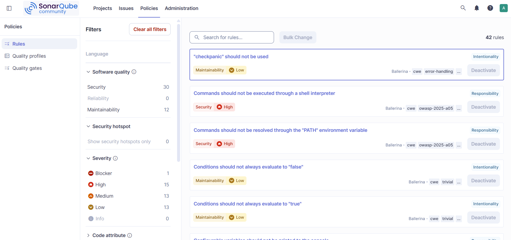

# Ballerina SonarQube Plugin

## Overview

SonarQube is an open-source code quality and security platform. It analyzes code for issues, tracks metrics, and integrates with CI/CD. This helps developers write cleaner, more secure code. [SonarQube plugins](https://docs.sonarsource.com/sonarqube/latest/extension-guide/developing-a-plugin/supporting-new-languages/) allow developers to extend SonarQube analysis  support for  new languages.The sonar-ballerina plugin extends SonarQube to analyze Ballerina code. It leverages the Ballerina static code analysis tool to identify issues and report them to SonarQube.

## Prerequisites

1. [Ballerina](https://ballerina.io/downloads/) 2201.13.0 (Swan Lake Update 13) or later

2. The [Ballerina scan tool](https://central.ballerina.io/ballerina/tool_scan/latest), installed as shown below

3. A self-managed [SonarQube](https://www.sonarsource.com/products/sonarqube/downloads/) server with Sonar Plugin API
   13.4 or later: SonarQube Community 26.1 or later, or SonarQube Server 2026.1 or later. See
   [Supported SonarQube versions](#supported-sonarqube-versions).

4. [SonarScanner CLI](https://docs.sonarsource.com/sonarqube-community-build/analyzing-source-code/scanners/sonarscanner/)
   7.2 or later. The latest version is recommended.

5. A JDK 21 installation to build the plugins from source, and a Java version supported by your SonarQube release to
   run the server

Both `bal` and `sonar-scanner` must be on the `PATH`.

### Supported SonarQube versions

The plugin is built against Sonar Plugin API 13.4 and tested on SonarQube Community 26.11.

| SonarQube | Supported versions |
|---|---|
| SonarQube Community (formerly Community Build) | 26.1 or later |
| SonarQube Server: Developer, Enterprise and Data Center editions | 2026.1 or later |
| SonarQube Cloud | Not supported, since it does not accept third-party plugins |

The plugin is installed the same way on every supported edition.

## Installing the scan tool

Pull the scan tool from Ballerina Central, and check that it is listed:

```bash
bal tool pull scan
bal tool list
```

To move an earlier installation to the latest version, run `bal tool update scan`. See the
[scan tool guide](https://ballerina.io/learn/scan-tool/) for its other options, such as `--list-rules`,
`--include-rules` and `--exclude-rules`.

## Installing SonarScanner CLI

1. Download the SonarScanner CLI archive for your OS from the
   [SonarScanner CLI page](https://docs.sonarsource.com/sonarqube-community-build/analyzing-source-code/scanners/sonarscanner/),
   and extract it.
2. Add its `bin` directory to the `PATH`, so that `bal scan` can run `sonar-scanner` (`sonar-scanner.bat` on Windows).
3. Check the installation:

   ```bash
   sonar-scanner -v
   ```

The archives for each OS bundle a Java runtime, so the scanner needs no separate Java installation. The server URL,
project key and token are set per project, as shown in
[`sonar-project.properties`](#sonar-projectproperties) and [Analyzing a Ballerina project](#analyzing-a-ballerina-project).

## Installing the plugins

The repository builds two plugins:

| Plugin | Built at | Used by |
|---|---|---|
| `sonar-ballerina-plugin` | `sonar-ballerina-plugin/build/libs/sonar-ballerina-plugin-<version>.jar` | The SonarQube server. It defines the Ballerina language, rules and quality profile, and reports the issues found. |
| `sonar-platform-plugin` | `sonar-platform-plugin/build/libs/sonar-platform-plugin-<version>.jar` | The `bal scan` tool. It saves the issues found and runs `sonar-scanner` to upload them. |

Download both JARs from the GitHub packages of this repository
([`sonar-ballerina-plugin`](https://github.com/ballerina-platform/sonar-ballerina/packages/2580146),
[`sonar-platform-plugin`](https://github.com/ballerina-platform/sonar-ballerina/packages/2580149)), or build them from
source. The build fetches `io.ballerina.scan:scan-command` from GitHub Packages, so first export your GitHub user name
as `packageUser` and a personal access token with the `read:packages` scope as `packagePAT`:

```bash
export packageUser=<github-user-name>
export packagePAT=<github-token>
./gradlew build
```

### Setting up the SonarQube server

1. Extract SonarQube. If your default Java is not a version the SonarQube release supports, set the `SONAR_JAVA_PATH`
   environment variable to the `java` executable of one that is.
2. Copy `sonar-ballerina-plugin-<version>.jar` to `<SONARQUBE_HOME>/extensions/plugins`.
3. Start the server with `<SONARQUBE_HOME>/bin/<OS>/sonar.sh start` (`StartSonar.bat` on Windows), or restart it if it
   is already running. The dashboard is at http://localhost:9000.
4. Create a project in the dashboard and note its project key.
5. Generate a token under **My Account > Security**, for use as `SONAR_TOKEN` below.

Once the plugin is loaded, the Ballerina rules are listed on the **Rules** page of the dashboard. Filter them by the
**Ballerina** language. On SonarQube Community 26.11, they look like this:



### Setting up the platform plugin

Keep `sonar-platform-plugin-<version>.jar` where your Ballerina projects can refer to it, and register it in their
`Scan.toml` as shown below.

## Configuring a Ballerina project

A Ballerina project needs a `Scan.toml` and a `sonar-project.properties` file to report to SonarQube.

### `Scan.toml`

The scan tool reads `Scan.toml` from the project root. To keep it elsewhere, set its path in `Ballerina.toml`:

```toml
[scan]
configPath = "config/Scan.toml"
```

A `[scan]` table without `configPath` is an error, so leave the table out when `Scan.toml` is at the project root.

In `Scan.toml`, register the SonarQube platform plugin:

```toml
[[platform]]
name = "sonarqube"
path = "/path/to/sonar-platform-plugin-<version>.jar"
# Optional: the sonar-project.properties file to use instead of the one at the project root
sonarProjectPropertiesPath = "/path/to/sonar-project.properties"
```

| Field | Required | Description |
|---|---|---|
| `name` | Yes | Must be `sonarqube`. |
| `path` | Yes | The path of `sonar-platform-plugin-<version>.jar`, absolute or relative to the project root. |
| `sonarProjectPropertiesPath` | No | The path of the properties file, passed to `sonar-scanner` as `project.settings`. A relative path is looked up next to `Scan.toml` first, then in the project. When it is not set, `sonar-scanner` reads `sonar-project.properties` from the directory `bal scan` runs in, so run it from the project root. |

### `sonar-project.properties`

Tell `sonar-scanner` which SonarQube server and project to report to:

```properties
sonar.projectKey=my_ballerina_project
sonar.host.url=http://localhost:9000
sonar.projectName=My Ballerina Project
```

| Property | Required | Description |
|---|---|---|
| `sonar.projectKey` | Yes | The unique key of the project in SonarQube. If the project does not exist, the first analysis creates it, but only when the token's user has the Create Projects permission. |
| `sonar.token` | Yes, unless anonymous analysis is allowed | A token to authenticate with the server. Set the `SONAR_TOKEN` environment variable instead, so that the token is not committed. |
| `sonar.host.url` | No | The URL of the SonarQube server. Defaults to `http://localhost:9000`. |
| `sonar.projectName` | No | The name shown in SonarQube. Defaults to the project key. |

When run through `bal scan`, the platform plugin sets these properties on the `sonar-scanner` command line, which
overrides any value set for them in `sonar-project.properties`:

| Property | Value |
|---|---|
| `sonar.exclusions` | Non-Ballerina files, such as `**/*.java`, `**/*.xml` and `**/*.py`, and the Ballerina test directories `tests/**` and `modules/*/tests/**`. |
| `sonar.tests` | `.` |
| `sonar.test.inclusions` | `tests/**,modules/*/tests/**`, so that the Ballerina tests are indexed as test code, not as source code. |
| `sonar.test.exclusions` | The same non-Ballerina files as `sonar.exclusions`. |
| `sonar.projectVersion` | The `version` of the `[package]` table in `Ballerina.toml`. It is not set when `Ballerina.toml` has no version. |
| `analyzedResultsPath` | The path of the issues found by `bal scan`. When it is set, the plugin reports the issues in that file instead of running `bal scan` again. |

When you run `sonar-scanner` directly, these properties are not set for you, so set the test directories in
`sonar-project.properties` if you want them indexed as test code.

The issues are saved to `ballerina-static-code-analysis-results.json` in the directory `bal scan` runs in (the
workspace root for a workspace), so add it to `.gitignore` there.

## Analyzing a Ballerina project

Set the token generated in SonarQube as the `SONAR_TOKEN` environment variable, then run either of these commands from
the project root:

- `bal scan --platforms=sonarqube` analyzes the project, and runs `sonar-scanner` to upload the issues found.
- `sonar-scanner` runs `bal scan --platform-triggered --platforms=sonarqube` to analyze the project, and uploads the
  issues found. Use it when `sonar-scanner` already runs in your CI pipeline.

Once the analysis is done, the issues appear in the project on the SonarQube server.

### Workspaces

A workspace `Scan.toml` cannot have `[[platform]]` entries, so give each member package its own `Scan.toml` with the
`sonarqube` entry. `bal scan` runs `sonar-scanner` once for each member, always in the directory `bal scan` runs in.
When you run it from the workspace root, every member reads the workspace root's `sonar-project.properties` and reports
to the same SonarQube project, so each member's analysis replaces the previous one.

To report each member to its own project, run `bal scan --platforms=sonarqube` from each member's directory, with a
`sonar-project.properties` that has its own `sonar.projectKey`. Pointing `sonarProjectPropertiesPath` at a per-member
file while running from the workspace root is not enough: `sonar-scanner` still uses the workspace root as its base
directory, so each project indexes the files of every member, `<member>/tests/**` is indexed as source code, and
`sonar.projectVersion` is not set.

## Rule metadata

The plugin loads its rules, including the "Why is this an issue?", "How can I fix it?" and "More info" sections shown
for each rule, from the `rule-info.json` file of the Ballerina static code analysis tool. When the SonarQube server
starts, the plugin uses the first of these sources that is available:

1. The `ruleInfoUrl` set in `sonar-ballerina-plugin/build.gradle`, or the `sonar.ballerina.ruleInfoUrl` property in
   `conf/sonar.properties` of the SonarQube server, which overrides it without rebuilding the plugin.
2. The `ruleInfoFallbackUrl` set in `sonar-ballerina-plugin/build.gradle`, which points to the `main` branch of the
   official scan tool repository. Rules without documentation there link to the
   [scan rules page](https://ballerina.io/learn/scan-rules/) instead.
3. The copy cached at `~/.sonar-ballerina/rule-info.json` by the last successful fetch.
4. The snapshot bundled from `sonar-ballerina-plugin/src/main/rule-info/rule-info.json`, with a warning that the rules
   may be outdated.

A source that cannot be reached within the timeout, does not respond with HTTP 200, or does not contain valid rules is
skipped with a warning. If none of the sources can be loaded, the SonarQube server fails to start. The rules are loaded
once per server start, so restart the server to pick up changes to `rule-info.json`.

The request to the first URL, including a URL set with `sonar.ballerina.ruleInfoUrl`, carries these query parameters, so that the endpoint can serve the rules that match the server. The fallback URL serves a static file, so it receives none of them.

| Parameter | Value |
|-----------|-------|
| `pluginVersion` | The version of this plugin, detected automatically. |
| `sonarVersion` | The version of the SonarQube server, such as `26.11.0.134175`, detected automatically. |
| `sonarEdition` | The edition of the SonarQube server: `community`, `developer`, `enterprise` or `datacenter`, detected automatically. |
| `scanToolVersion` | The version of the Ballerina scan tool that the projects are analyzed with, such as `0.14.0`. The SonarQube server does not run the scan tool, so set it with the `sonar.ballerina.scanToolVersion` property in `conf/sonar.properties`. Defaults to `latest`. |

For example, `https://example.com/rule-info.json?pluginVersion=0.4.1&sonarVersion=26.11.0.134175&sonarEdition=community&scanToolVersion=latest`. Since the rules are loaded once per server start, restart the server after changing `sonar.ballerina.scanToolVersion`. The cached copy and the bundled snapshot do not depend on the scan tool version, so they are used as they are when the URLs cannot be loaded.

To refresh the bundled snapshot from `ruleInfoUrl`, run `./gradlew :sonar-ballerina-plugin:updateRuleInfoSnapshot`, and
review the diff before committing it.

See [Writing rule-info.json entries](sonar-ballerina-plugin/src/main/rule-info/README.md) for how to decide the
value of each field, and how to derive it from the `rules.json` file of each analyzer.

## Contribute to Ballerina

As an open-source project, Ballerina welcomes contributions from the community.

For more information, go to the [contribution guidelines](https://github.com/ballerina-platform/ballerina-lang/blob/master/CONTRIBUTING.md).

## Code of conduct

All the contributors are encouraged to read the [Ballerina Code of Conduct](https://ballerina.io/code-of-conduct).

## Useful links

* Chat live with us via our [Discord server](https://discord.gg/ballerinalang).
* Post all technical questions on Stack Overflow with the [#ballerina](https://stackoverflow.com/questions/tagged/ballerina) tag.
